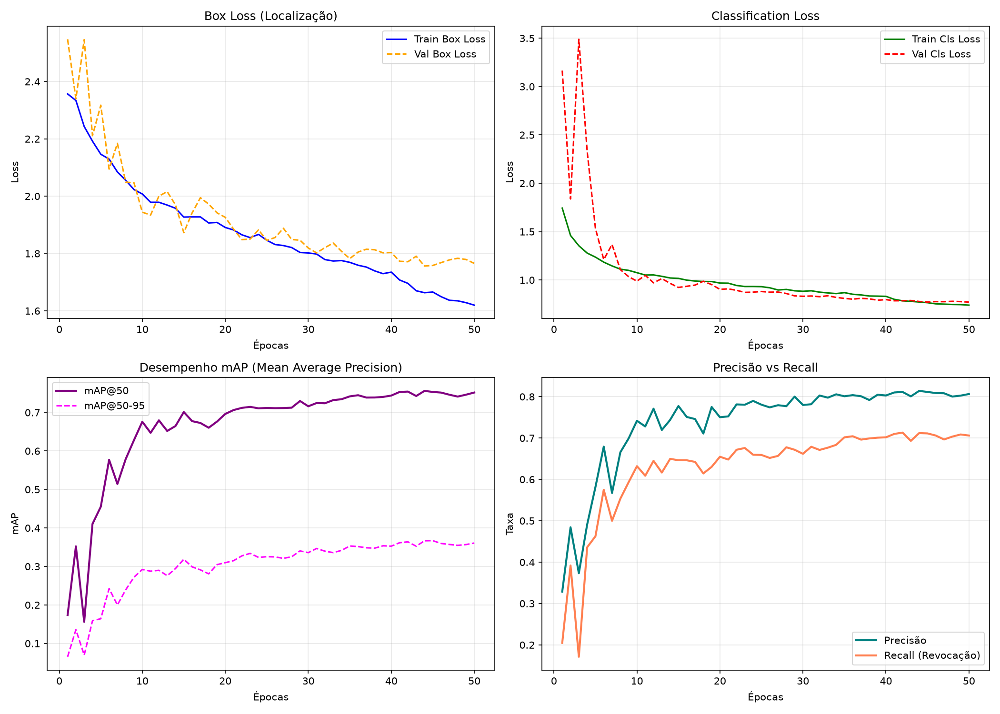
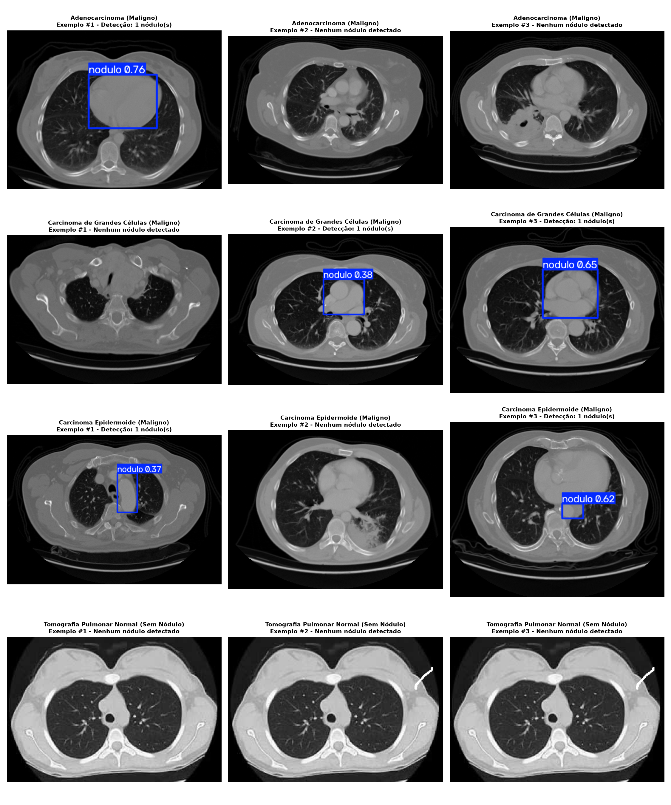

# Early Lung Nodule Detection — Computer-Aided Diagnosis (CAD) with YOLOv8

[](https://www.python.org/)
[](https://pytorch.org/)
[](https://github.com/ultralytics/ultralytics)
[](https://wiki.cancerimagingarchive.net/display/Public/LIDC-IDRI)
[](LICENSE)

Computer vision system for **early lung nodule localization** in axial Chest Computed Tomography (CT) scans using **YOLOv8**. Developed as an undergraduate thesis project (TCC) to support early-stage lung cancer screening and clinical workflow triage.

> **Clinical Scope:** The model performs **spatial object localization** (`detect` with bounding boxes) targeting the nodule itself within axial CT slices, rather than simple binary patient-level classification.

---

## Key Highlights & Performance

* **Optimal Model:** YOLOv8s trained on **LIDC-IDRI** (50 epochs, $224 \times 224$, `AdamW`)
* **Validation Performance:**
  * **Precision:** **80.9%**
  * **Recall:** **71.2%**
  * **mAP@50:** **75.4%**
  * **mAP@50-95:** **36.7%**
* **Zero False Alarm Calibration:** At operational threshold **`conf = 0.35`**, the model achieves **100% specificity (0.0% false positive rate)** across healthy/normal lung CTs while retaining robust detection sensitivity (confidence scores up to 76%) on malignant cases.

---

## Visual Overview

### 1. Training & Convergence Dynamics
Loss curves and detection metrics extracted directly from the final checkpoint weights (`best.pt`):



### 2. Clinical Validation Across Pathology Types (`conf = 0.35`)
Inference across 40 real thoracic CT slices (Adenocarcinoma, Large Cell Carcinoma, Squamous Cell Carcinoma, and Normal lungs):



---

## Repository Structure

```
.
├── README.md                          # Project overview, key metrics, and visual summary (English)
├── README_TREINAMENTO_IA.md           # Full project guide in Portuguese
├── METODOLOGIA_TCC_ABNT.md            # Formal academic methodology & dataset justification (ABNT standard)
├── GUIA_INFORMAL_ESTUDO_E_DUVIDAS.md  # Informal study guide, Q&A, and 100% remote cloud workflow notes
├── experiment_log.md                  # Full research log: dataset methodology, curves, threshold tests & bugs
├── deeplesion_tests.md                # Multi-organ generalization experiments with DeepLesion
├── train_lidc_por_paciente.py         # Complete Colab training script (patient-level split + healthy CT controls)
└── assets/                            # Training curves, threshold montages, and inference test images
```

---

## Datasets & Methodology

| Dataset | Nature | Scope | Usable Slices | Outcome |
| :--- | :--- | :--- | :---: | :--- |
| **DeepLesion** (NIH) | Multi-organ lesions | Generic (liver, kidney, lung, abdomen) | 1,327 | **Discarded** (poor lung specificity, mAP50: 32.9%) |
| **LIDC-IDRI** | Thoracic CT | Dedicated early lung nodules | 15,486 | **Selected** (high specificity, mAP50: 75.4%) |

### 4-Radiologist Consensus Mask Fusion
In the LIDC-IDRI dataset, each nodule includes independent segmentation masks drawn by four board-certified radiologists. To eliminate individual annotator bias and maximize ground-truth robustness:
$$\text{Ground Truth Mask} = \text{Mask}_1 \cup \text{Mask}_2 \cup \text{Mask}_3 \cup \text{Mask}_4$$
A pixel is classified as nodule tissue if marked by **at least one** radiologist. The minimal bounding rectangle enclosing this unified mask defines the training bounding box.

---

## Training Run Comparisons

| Model | Dataset | Epochs | Image Size | Optimizer | Precision | Recall | mAP@50 |
| :--- | :--- | :---: | :---: | :---: | :---: | :---: | :---: |
| **YOLOv8n** | DeepLesion | 30 | 512 | Default | 0.317 | 0.246 | 0.208 |
| **YOLOv8s** | DeepLesion | 100 | 512 | Default | 0.557 | 0.304 | 0.329 |
| **YOLOv8s** | **LIDC-IDRI** | **50** | **224** | **AdamW** | **0.809** | **0.712** | **0.754** |

Switching from a generic multi-organ lesion dataset to a lung-specific consensus dataset provided a **+42.5 percentage point increase in mAP@50**.

---

## Operational Threshold Calibration (`conf`)

A critical challenge in medical CAD systems is avoiding clinician alarm fatigue caused by false positives. We evaluated 40 independent CT slices at varying thresholds:

| Confidence (`conf`) | Adenocarcinoma (10) | Large Cell (10) | Squamous Cell (10) | Normal / Healthy (10) | False Positive Rate |
| :---: | :---: | :---: | :---: | :---: | :---: |
| **0.10** | 7 / 10 | 10 / 10 | 7 / 10 | 10 / 10 | 100% |
| **0.20** | 6 / 10 | 6 / 10 | 7 / 10 | 10 / 10 | 100% |
| **0.25** | 5 / 10 | 6 / 10 | 7 / 10 | 8 / 10 | 80% |
| **0.30** | 3 / 10 | 6 / 10 | 6 / 10 | 2 / 10 | 20% |
| **0.35 (Recommended)** | **3 / 10** | **6 / 10** | **6 / 10** | **0 / 10** | **0.0% (Zero False Alarms)** |
| **0.40** | 3 / 10 | 5 / 10 | 4 / 10 | 0 / 10 | 0.0% |

* Detailed qualitative samples and edge cases are documented in [`experiment_log.md`](experiment_log.md).

---

## Key Findings & Engineering Notes

1. **Optimizer Selection:** Default optimizer in Ultralytics triggered a `RuntimeError: view size is not compatible...` in `optim/muon.py`. Resolved by explicitly setting `optimizer="AdamW"`.
2. **Modal Specificity (CT vs. X-Ray):** Testing the model on conventional 2D chest radiographs (X-Rays) produced 0 detections. This is correct behavior: the feature space of 2D overlapping projection radiography differs fundamentally from transverse tomographic slices.
3. **Miliary & Sub-centimetric Nodules:** The model is highly effective on solitary nodules (> 5mm) but shows lower sensitivity on diffuse miliary nodule patterns (< 3mm).

---

## Next Steps

- [ ] Export checkpoint (`best.pt`) to **TensorFlow Lite (TFLite)** and **ONNX** for optimized edge deployment.
- [ ] Retrain at native resolution ($512 \times 512$) to improve recall on sub-centimetric micronodules.
- [ ] Develop a lightweight desktop/web UI for interactive radiological slice inspection.

---

## Citation & Academic Context

Developed as part of an Undergraduate Thesis (TCC) in Computer Science / Engineering.

For full experimental methodologies, loss curves, and side studies, refer to [`experiment_log.md`](experiment_log.md).
