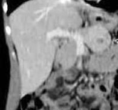
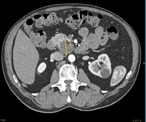
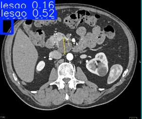
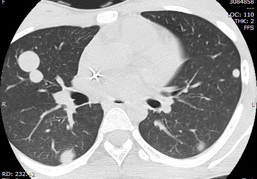
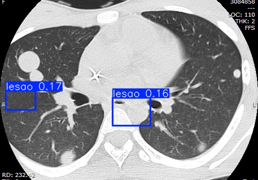

# DeepLesion Model Tests (Generic Multi-Organ Lesion Detection)

Separate from the main experiment (LIDC-IDRI/lung nodule). Here the goal is
different: test whether the model trained on **DeepLesion** (generic
`lesion` class, covering any organ) recognizes anything in images from
different organs — since this was the dataset discarded as the main
choice for not being lung-specific.

Model: `best.pt` from the YOLOv8s/DeepLesion run (100 epochs) —
`mAP50 = 0.329`, `precision = 0.557`, `recall = 0.304` on the original
validation set.

## Test 01 — Pancreas/liver (close crop)

| Original | Model detection |
|---|---|
|  |  |

- **Result: 0 detections.**

## Test 02 — Abdomen (pancreas/kidney, wide crop)

| Original | Model detection |
|---|---|
|  |  |

- **Result: 3 detections**, confidences 0.52 / 0.19 / 0.16.
- **Note:** the third box has near-degenerate coordinates (width and height
  close to zero — `[0.21, 0.0, 16.0, 0.0]`), a sign of a spurious/invalid
  detection, not a real lesion. The other two have low-to-moderate
  confidence — they need visual/clinical validation before meaning
  anything.

## Test 03 — Lung (same CT as Test 04 in the main experiment)

| Original | Model detection |
|---|---|
|  |  |

- **Result: 2 detections**, confidences 0.17 / 0.16 — both low.
- Compare with the LIDC-IDRI model on the same image (Test 04 in the main
  document, `experiment_log.md`): there, one detection appeared at
  confidence 0.29, moderately higher than here.

## Preliminary reading (to be expanded)

- Across these 3 tests, the DeepLesion model didn't show a clear, reliable
  ability to generalize detection across different organs: low confidence
  in almost every case, plus one clearly invalid detection in Test 02.
- This empirically reinforces the decision already made to not use
  DeepLesion as the project's main dataset — it doesn't seem to have
  learned a robust concept of "lesion" that generalizes well across
  organs, at least with the amount of data/epochs used here.
- **Important:** this is a very small sample (3 images) — not enough for
  any statistical conclusion. It serves as initial qualitative evidence,
  not formal validation.
