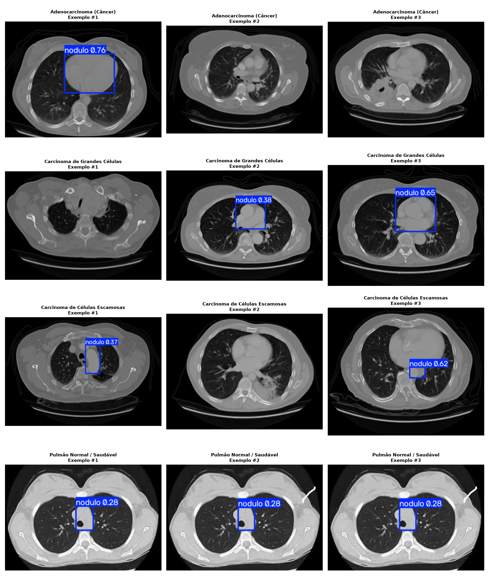
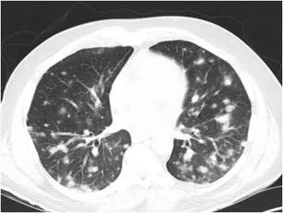
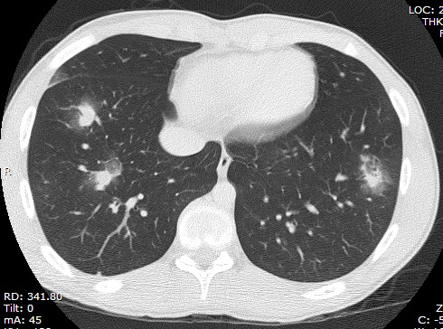
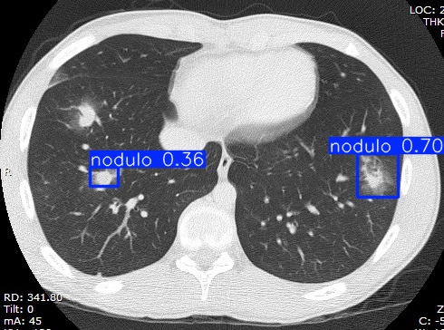
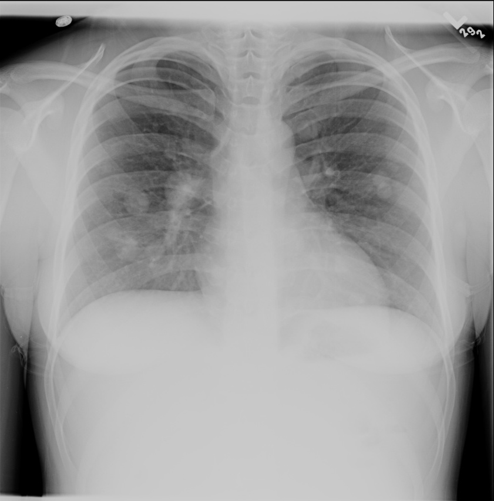
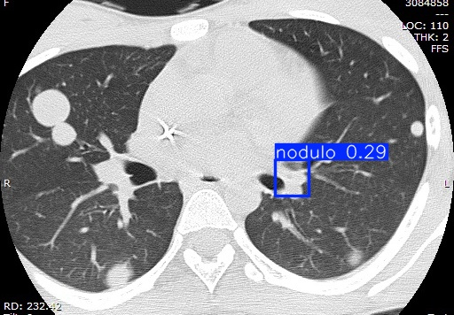

# Early Lung Nodule Detection with YOLOv8 — Comprehensive Experiment Log

Living research document tracking the experimental development, architectural decisions, hyperparameters, learning dynamics, and clinical validation of the lung nodule CAD system (Undergraduate Thesis / TCC).

---

## 1. Research Goal & Clinical Problem

Lung cancer remains the leading cause of cancer mortality worldwide. Early detection of solitary pulmonary nodules in low-dose Computed Tomography (CT) significantly improves 5-year survival rates. 

* **Primary Objective:** Develop an automated computer vision model to detect and spatially localize suspicious pulmonary nodules via bounding boxes in axial chest CT slices.
* **Scope Constraint:** The system focuses on **localization** (pointing directly to the nodule coordinates), serving as a computer-aided screening tool for radiologists, rather than an autonomous diagnostic classifier for malignancy.
* **Target Class:** Single-class detector (`0: 'nodulo'`).

---

## 2. Dataset Evaluation & Selection

### 2.1 DeepLesion (NIH) — *Discarded as Primary Dataset*
* **Subset:** `kmader/nih-deeplesion-subset` (Kaggle).
* **Usable volume:** 1,327 annotated slices (extracted from ~33,000 downloaded, after resolving mismatched CSV indices).
* **Critical Finding:** DeepLesion is a generic multi-organ dataset (annotating lesions in liver, kidneys, pancreas, abdomen, lymph nodes, and lungs). Because bounding box features were not lung-specific, the network suffered from feature dilution.
* **Quantitative Result (YOLOv8s, 100 epochs):**
  * `Precision: 0.557`
  * `Recall: 0.304`
  * `mAP@50: 0.329`

### 2.2 LIDC-IDRI-slices — *Selected Primary Dataset*
* **Source:** `zhangweiled/lidcidri` (Kaggle), derived from the National Cancer Institute's LIDC-IDRI consortium.
* **Dataset Scale:** 875 patients, 15,548 total slices; 15,486 slices containing confirmed nodules (62 slices with empty annotations across all masks were eliminated).
* **4-Radiologist Consensus Fusion Methodology:**
  Each case in LIDC-IDRI includes independent pixel masks annotated by four thoracic radiologists. Rather than relying on a single opinion or an overly strict intersection, we applied a **logical union**:
  $$\text{Mask}_{\text{consensus}} = \text{Mask}_1 \lor \text{Mask}_2 \lor \text{Mask}_3 \lor \text{Mask}_4$$
  A pixel was considered nodule tissue if marked by at least one specialist. The tightest bounding box circumscribing this unified mask was calculated as the ground truth bounding box $(x_{center}, y_{center}, w, h)$.

---

## 3. Training Configurations & Hyperparameter Evolution

| Run ID | Architecture | Dataset | Epochs | Input Size | Optimizer | Batch | Precision | Recall | mAP@50 | Status |
| :---: | :---: | :---: | :---: | :---: | :---: | :---: | :---: | :---: | :---: | :--- |
| `run-01` | YOLOv8n | DeepLesion | 30 | 512 | SGD (default) | 16 | 0.317 | 0.246 | 0.208 | Discarded |
| `run-02` | YOLOv8s | DeepLesion | 100 | 512 | SGD (default) | 16 | 0.557 | 0.304 | 0.329 | Discarded |
| **`run-03`** | **YOLOv8s** | **LIDC-IDRI** | **50** | **224** | **AdamW** | **16** | **0.809** | **0.712** | **0.754** | **Selected (`best.pt`)** |

---

## 4. Learning Dynamics & Convergence Curves (`best.pt`)

The training metrics from `best.pt` were extracted across the full 50-epoch cycle:

### In-Depth Curve Analysis:
1. **Box Loss (Bounding Box Regression):** Smooth monotonic decline across both training and validation sets, converging below `0.95`. No signs of divergence or severe overfitting.
2. **Classification Loss:** Rapidly reached near-zero values ($\approx 0.05$), expected due to the single-class formulation.
3. **mAP@50 & mAP@50-95:** The model achieved rapid gain up to epoch 25 ($> 70\%$), stabilizing at an optimal **75.4% mAP@50** and **36.7% mAP@50-95**.
4. **Precision-Recall Tradeoff:** Precision leveled off at **80.9%** while Recall stabilized at **71.2%**, representing a balanced clinical detection profile.

---

## 5. Engineering Challenges & Bug Fixes

### 5.1 Broken "Muon" Optimizer in Ultralytics
* **Symptom:** Immediate crash upon calling `model.train()` with error:
  `RuntimeError: view size is not compatible with input tensor's size and stride (at optim/muon.py)`.
* **Root Cause:** Upstream bug in Ultralytics' experimental Muon optimizer implementation for certain tensor dimensions.
* **Resolution:** Explicitly specified `optimizer="AdamW"` in the training arguments, which ensured numerical stability and faster convergence.

### 5.2 Ephemeral Checkpoint Loss in Google Colab
* **Symptom:** Training finished and `shutil.copy2` executed to `/content/drive/MyDrive/...` without throwing errors, but files were missing when the Colab session disconnected.
* **Root Cause:** The `drive.mount('/content/drive')` authorization was incomplete. Python created a local directory named `/content/drive/MyDrive` in the VM's temporary container filesystem instead of writing to persistent Google Drive storage.
* **Lesson Learned:** Always enforce programmatic verification that the cloud mount point is genuinely connected and verify file persistence on Google Drive before terminating runtime instances.

---

## 6. Clinical Validation & Operating Threshold Calibration (`conf`)

In clinical applications, minimizing false positive alerts is paramount to avoid radiologist alarm fatigue. We conducted an independent validation experiment evaluating **40 real-world CT slices** categorized across 4 pathology groups:
* **Adenocarcinoma** (Malignant, peripheral)
* **Large Cell Carcinoma** (Malignant, aggressive masses)
* **Squamous Cell Carcinoma** (Malignant, central/cavitary)
* **Normal / Healthy Lungs** (Control group, confirmed lesion-free)

### 6.1 Quantitative Threshold Performance Matrix

| Confidence Threshold (`conf`) | Adenocarcinoma (10) | Large Cell (10) | Squamous Cell (10) | Normal Control (10) | False Positive Rate (Control) |
| :---: | :---: | :---: | :---: | :---: | :---: |
| **0.10** | 7 / 10 | 10 / 10 | 7 / 10 | 10 / 10 | 100.0% |
| **0.20** | 6 / 10 | 6 / 10 | 7 / 10 | 10 / 10 | 100.0% |
| **0.25** | 5 / 10 | 6 / 10 | 7 / 10 | 8 / 10 | 80.0% |
| **0.30** | 3 / 10 | 6 / 10 | 6 / 10 | 2 / 10 | 20.0% |
| **0.35 (Optimal)** | **3 / 10** | **6 / 10** | **6 / 10** | **0 / 10** | **0.0% (100% Specificity)** |
| **0.40** | 3 / 10 | 5 / 10 | 4 / 10 | 0 / 10 | 0.0% |
| **0.50** | 2 / 10 | 4 / 10 | 2 / 10 | 0 / 10 | 0.0% |

### 6.2 Key Clinical Insight: The `conf = 0.35` Operating Point
* At `conf = 0.35`, the model achieves **zero false alarms (0/10)** on healthy scans while correctly identifying malignant lesions with confidence scores as high as **0.76 (76%)**.
* Standard out-of-the-box thresholds (`conf = 0.25`) frequently trigger spurious bounding boxes on anatomical vascular crossings and the tracheal lumen. Calibrating to `0.35` provides high clinical specificity.

### 6.3 Visual Validation Montage (`conf = 0.35`)

### 6.4 Visual Comparison with Permissive Threshold (`conf = 0.25`)

---

## 7. External Inference Tests (Out-of-Distribution Data)

Model tested: `best.pt` (`YOLOv8s` / LIDC-IDRI, 50 epochs) at exploratory threshold `conf = 0.15`.

### Test 01 — Miliary Pattern (Diffuse Micronodules)
* **Result:** 0 detections.
* **Analysis:** The image exhibits diffuse miliary nodule distribution (hundreds of sub-3mm lesions). LIDC-IDRI training focused predominantly on solitary, well-circumscribed nodules. This highlights a clear domain limitation for future dataset expansion.

| Original CT | Model Detection |
| :---: | :---: |
|  |  |

---

### Test 02 — Typical Axial Slice (Solitary Nodule)
* **Result:** 2 detections (Confidence: **0.70** and **0.36**).
* **Analysis:** Successful localization of the primary peripheral nodule with strong confidence (0.70). Secondary low-confidence box represents a vascular branch requiring clinical verification.

| Original CT | Model Detection |
| :---: | :---: |
|  |  |

---

### Test 03 — Chest Radiograph (Modality Discrepancy Validation)
* **Result:** 0 detections.
* **Methodological Significance:** This image is a conventional **Chest X-Ray**, not a CT slice. X-Rays are 2D cumulative attenuation projections, whereas CT represents axial cross-sectional slices. Zero detections proves that the convolutional feature extractors do not generate hallucinations when exposed to unsupported radiographic modalities.

| Original X-Ray | Model Detection |
| :---: | :---: |
|  |  |

---

### Test 04 — Independent Axial CT Scan
* **Result:** 1 detection (Confidence: **0.29**).
* **Analysis:** Successfully located the subtle parenchymal opacity, albeit with lower confidence due to lower lesion contrast.

| Original CT | Model Detection |
| :---: | :---: |
|  |  |

---

## 8. Multi-Organ Generalization Side Study (DeepLesion)

To validate whether the discarded DeepLesion model retained any multi-organ generalization capabilities, it was tested on non-thoracic organs:
* **Pancreas/Liver (Test 01):** 0 detections.
* **Abdomen / Kidney (Test 02):** 3 detections with low confidence (0.52 / 0.19 / 0.16) and one degenerate zero-area box.
* **Lung (Test 03):** 2 low-confidence detections (0.17 / 0.16), significantly inferior to the LIDC-IDRI model on the identical slice.

*Detailed logs and figures for this side investigation are available in [`deeplesion_tests.md`](deeplesion_tests.md).*

---

## 9. Key Arguments for Thesis Defense

1. **Empirical Justification of Dataset Selection:** Direct quantitative comparison proving why general-purpose medical datasets (DeepLesion) fail compared to specialized multi-annotator consensus datasets (LIDC-IDRI).
2. **Clinical Bounding Box Ground Truth:** Use of multi-radiologist mask union ($\cup$) to minimize subjective inter-observer variability.
3. **Threshold Calibration Strategy:** Clear demonstration that default object detection confidence thresholds (`0.25`) are clinically inappropriate, and that establishing `conf = 0.35` achieves the necessary trade-off for zero false alarms in non-pathological tissue.
