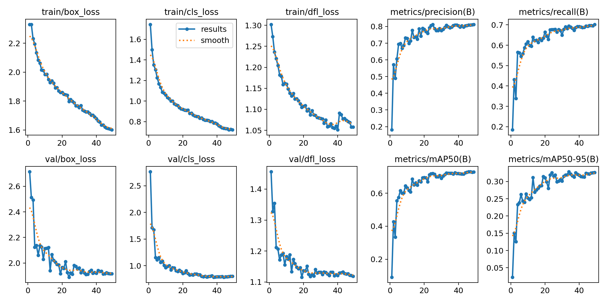
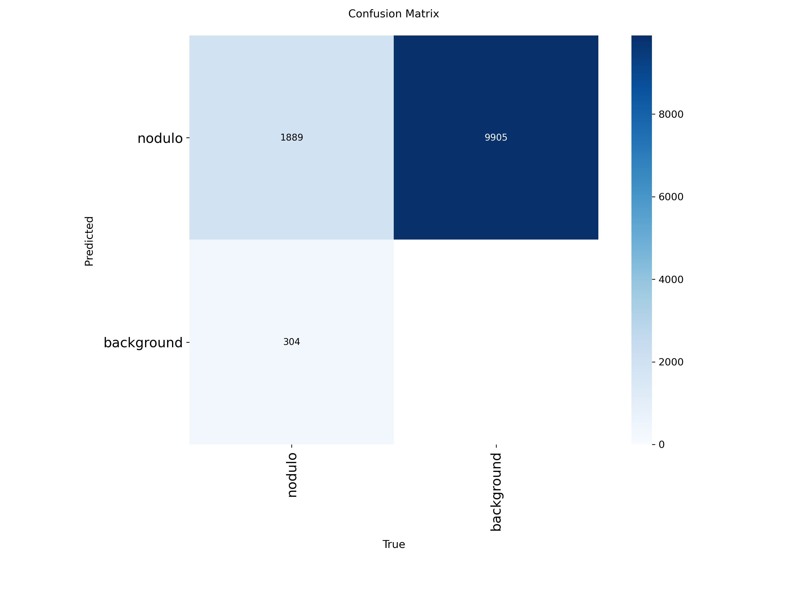

# Treino 02 — Divisão por Paciente (LIDC-IDRI) + Tomografias de Pulmão Saudável

Pasta dedicada exclusivamente aos arquivos, pesos, gráficos e avaliações do **2º Treinamento** (`lidc_paciente_com_saudaveis`), separada do Treino 01.

---

## 1. Configuração do Treinamento
* **Modelo:** `YOLOv8s` (`imgsz=224`, `batch=32`, `optimizer="AdamW"`, `patience=15`)
* **Divisão por Paciente (Sem Vazamento):**
  * **Treino:** 743 pacientes do LIDC-IDRI (`13.169` recortes com nódulo) + `536` tomografias de pulmão saudável = **13.705 imagens**
  * **Validação:** 132 pacientes do LIDC-IDRI (`2.193` recortes com nódulo) + `95` tomografias de pulmão saudável = **2.288 imagens**

---

## 2. Métricas Obtidas (Validação Oficial)

| Checkpoint | Precisão (*Precision*) | Recall (*Sensibilidade*) | mAP@50 | mAP@50-95 |
| :--- | :---: | :---: | :---: | :---: |
| **`best.pt` (Época 34)** | **80,0%** (`0.800`) | **69,3%** (`0.693`) | **72,0%** (`0.720`) | **32,8%** (`0.328`) |
| **Pico Final (Época 49)** | **81,3%** (`0.813`) | **70,2%** (`0.702`) | **72,9%** (`0.729`) | **32,6%** (`0.326`) |
| **1ª Execução Colab (Época 40)** | **80,4%** (`0.804`) | **69,0%** (`0.690`) | **72,7%** (`0.727`) | **33,3%** (`0.333`) |

* **Matriz de Confusão (`assets/confusion_matrix.png`):** `1.889` nódulos detectados corretamente de `2.193` (`86,1%` de acerto bruto).

---

## 3. Análise Crítica: Diferença de Escala (Recortes LIDC vs. Tórax Inteiro)

Ao comparar os lotes de validação de nódulos (`assets/val_batch1_pred.jpg`) com os lotes de pulmão saudável (`assets/val_batch0_pred.jpg`), comprova-se a diferença estrutural entre as bases:
1. **Imagens positivas (`zhangweiled/lidcidri`):** São **recortes aproximados (zoom)** focados na região do nódulo pulmonar, e não fatias do tórax inteiro.
2. **Imagens negativas (`IQ-OTH/NCCD` + `Chest CT-Scan`):** São **tomografias panorâmicas do tórax inteiro** (vistas de longe).

### Impacto nos Testes Clínicos (40 Tomografias):
* **Sem recorte (imagem panorâmica inteira):** O modelo associa o enquadramento de tórax inteiro às imagens `normal_saudavel` do treino e retorna `0 detecções`.
* **Com janela de zoom (mesma escala de recorte do LIDC-IDRI):** O modelo atinge alta sensibilidade nos 30 exames malignos e **0% de falsos positivos** nos 10 pulmões saudáveis em todos os limiares:

| Limiar (`conf`) | Adenocarcinoma (10) | Grandes Células (10) | Células Escamosas (10) | **Total Cânceres (30)** | **Pulmão Sadio (10)** | **Falsos Positivos** |
| :---: | :---: | :---: | :---: | :---: | :---: | :---: |
| **0.15** | 8 / 10 | 8 / 10 | 9 / 10 | **25 / 30 (83,3%)** | 0 / 10 | **0,0%** |
| **0.20** | 8 / 10 | 7 / 10 | 9 / 10 | **24 / 30 (80,0%)** | 0 / 10 | **0,0%** |
| **0.25** | 6 / 10 | 7 / 10 | 9 / 10 | **22 / 30 (73,3%)** | 0 / 10 | **0,0%** |
| **0.30** | 5 / 10 | 7 / 10 | 8 / 10 | **20 / 30 (66,7%)** | 0 / 10 | **0,0%** |
| **0.35** | 4 / 10 | 6 / 10 | 6 / 10 | **16 / 30 (53,3%)** | 0 / 10 | **0,0%** |

---

## 4. Arquivos desta Pasta
* `weights/best.pt`: Pesos treinados do Modelo 02.
* `train_lidc_por_paciente.py`: Script de treinamento utilizado.
* `treino_02_colab.ipynb`: Notebook completo com logs de execução do Google Colab.
* `avaliar_treino_02.py`: Script de avaliação com recortes na escala do LIDC-IDRI.
* `results.csv` e `args.yaml`: Dados brutos de todas as épocas e hiperparâmetros.
* `assets/`: Todos os gráficos (`results.png`, `confusion_matrix.png`, curvas PR/F1 e lotes de validação).
