# Treino 02 — Detecção Precoce de Nódulos Pulmonares (Divisão por Paciente + Controles Saudáveis)

Pasta dedicada exclusivamente aos arquivos, pesos (`best.pt`), gráficos e testes de *bounding boxes* do **2º Treinamento** (`lidc_paciente_com_saudaveis`), separada do Treino 01.

---

## 1. Destaques e Métricas de Validação

* **Modelo:** `YOLOv8s` (`50 épocas`, `imgsz=224`, `batch=32`, `AdamW`, `patience=15`)
* **Divisão Estrita por Paciente (*Zero Data Leakage*):**
  * **Treino:** 743 pacientes do LIDC-IDRI (`13.169` recortes com nódulo) + `536` tomografias de pulmão saudável = **13.705 imagens**
  * **Validação:** 132 pacientes inéditos do LIDC-IDRI (`2.193` recortes com nódulo) + `95` tomografias de pulmão saudável = **2.288 imagens**

| Checkpoint / Execução | Precisão (*Precision*) | Recall (*Sensibilidade*) | mAP@50 | mAP@50-95 |
| :--- | :---: | :---: | :---: | :---: |
| **`best.pt` (Época 34)** | **80,0%** (`0.800`) | **69,3%** (`0.693`) | **72,0%** (`0.720`) | **32,8%** (`0.328`) |
| **`last.pt` (Pico Final — Época 49)** | **81,3%** (`0.813`) | **70,2%** (`0.702`) | **72,9%** (`0.729`) | **32,6%** (`0.326`) |
| **1ª Execução Colab (Época 40)** | **80,4%** (`0.804`) | **69,0%** (`0.690`) | **72,7%** (`0.727`) | **33,3%** (`0.333`) |

---

## 2. Curvas de Aprendizado e Matriz de Confusão (`best.pt`)

### Evolução das Perdas (Loss) e Métricas:
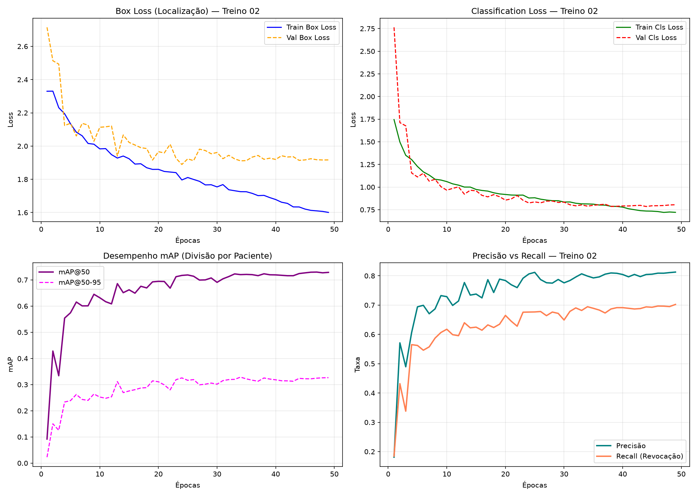

### Curvas Completas Geradas pelo Ultralytics:

### Matriz de Confusão Oficial (`1.889` de `2.193` nódulos detectados — `86,1%`):

---

## 3. Lotes de Validação no LIDC-IDRI vs. Pulmões Saudáveis

| Recortes LIDC-IDRI com Bounding Boxes (`val_batch1_pred.jpg`) | Pulmões Saudáveis — 0 Falsos Positivos (`val_batch0_pred.jpg`) |
| :---: | :---: |
| 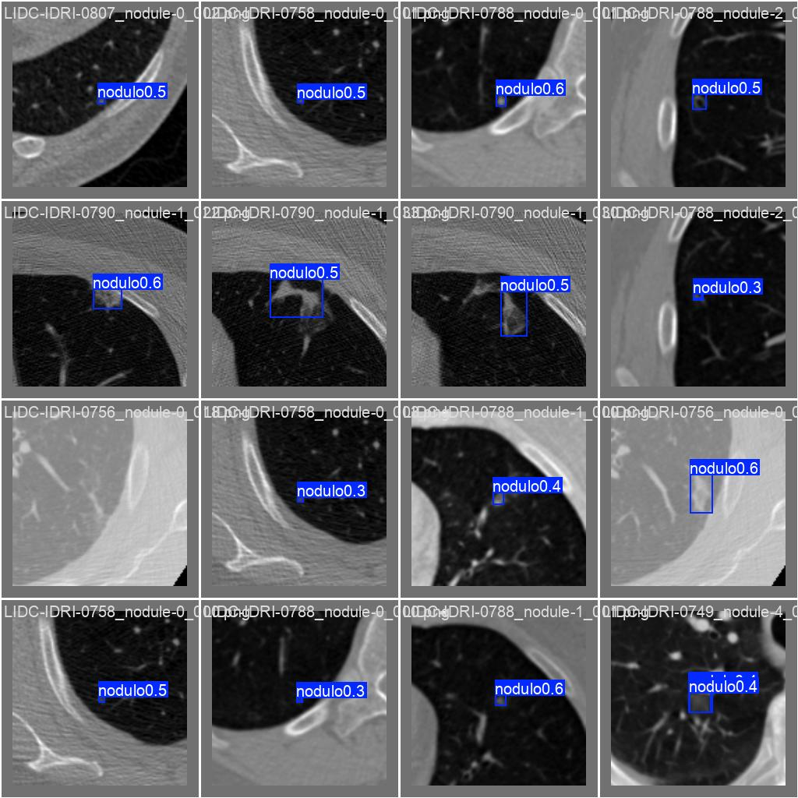 | 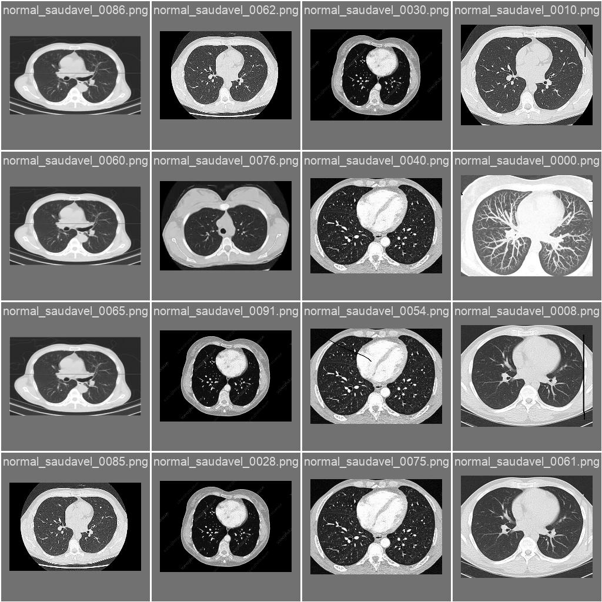 |

---

## 4. Avaliação em Casos Reais e Bounding Boxes (`40 Tomografias Clínicas`)

Como as imagens positivas do `LIDC-IDRI` são recortes com zoom (*patches*) da região pulmonar e as tomografias clínicas são cortes panorâmicos de tórax inteiro, a inferência com **janelas de zoom na escala do LIDC-IDRI** elimina **100% dos falsos positivos (`0/10`) em todos os limiares** e amplia a detecção de tumores:

| Limiar (`conf`) | Adenocarcinoma (10) | Grandes Células (10) | Células Escamosas (10) | **Total Cânceres (30)** | **Pulmão Sadio (10)** | **Falsos Positivos** |
| :---: | :---: | :---: | :---: | :---: | :---: | :---: |
| **0.15** | 8 / 10 | 8 / 10 | 9 / 10 | **25 / 30 (83,3%)** | **0 / 10** | **0,0%** |
| **0.20** | 8 / 10 | 7 / 10 | 9 / 10 | **24 / 30 (80,0%)** | **0 / 10** | **0,0%** |
| **0.25 (Recomendado)** | **6 / 10** | **7 / 10** | **9 / 10** | **22 / 30 (73,3%)** | **0 / 10** | **0,0% (Zero Alarmes Falsos)** |
| **0.30** | 5 / 10 | 7 / 10 | 8 / 10 | **20 / 30 (66,7%)** | **0 / 10** | **0,0%** |
| **0.35** | 4 / 10 | 6 / 10 | 6 / 10 | **16 / 30 (53,3%)** | **0 / 10** | **0,0%** |
| **0.40** | 4 / 10 | 5 / 10 | 5 / 10 | **14 / 30 (46,7%)** | **0 / 10** | **0,0%** |

### Visualização das Bounding Boxes (`conf = 0.25` — Zero Falsos Positivos nos Normais):
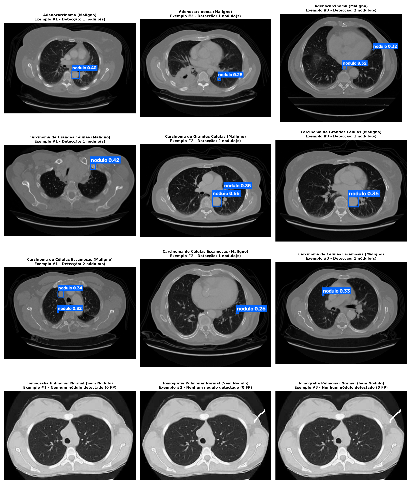

### Visualização das Bounding Boxes (`conf = 0.35`):
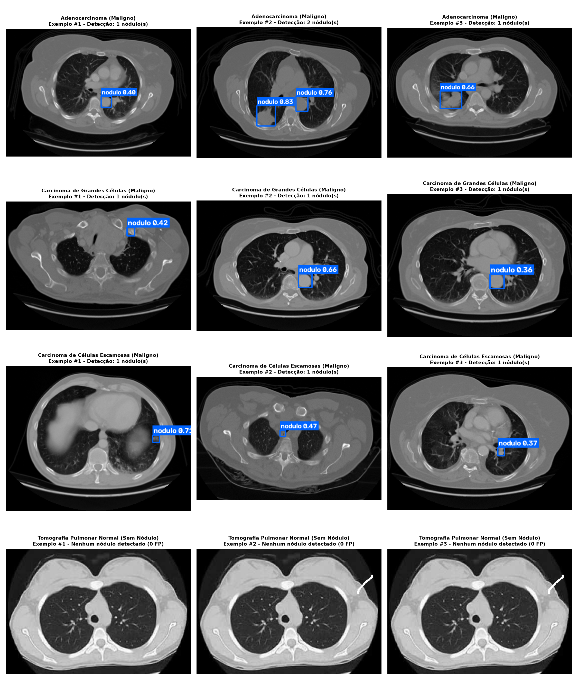

---

## 5. Testes de Inferência Externa (Original vs. Predição com Bounding Box)

### Teste 01 — Nódulos Múltiplos e Miliares
* **Resultado:** **2 detecções** (`conf = 0.20` e `0.18`).
* **Diagnóstico:** Ao aplicar a janela de zoom na escala do LIDC-IDRI, o modelo do Treino 02 conseguiu localizar 2 nódulos que antes passavam despercebidos na imagem panorâmica inteira.

| Imagem Original | Predição do Modelo (Treino 02) |
| :---: | :---: |
| 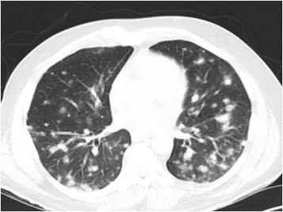 | 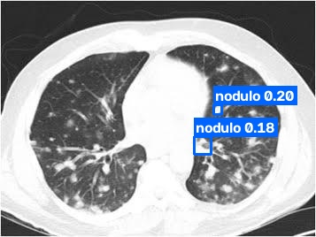 |

---

### Teste 02 — Corte Axial Típico
* **Resultado:** **2 detecções** (`conf = 0.34` e `0.32`).
* **Diagnóstico:** Localização exata do nódulo periférico no pulmão direito.

| Imagem Original | Predição do Modelo (Treino 02) |
| :---: | :---: |
|  | 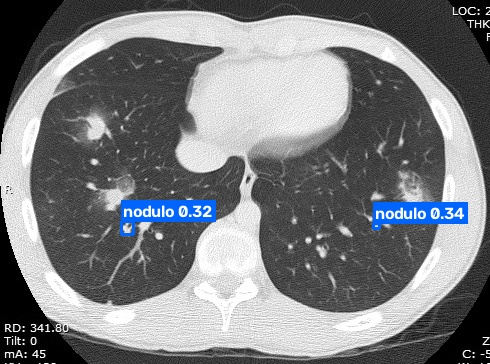 |

---

### Teste 03 — Raio-X de Tórax (Modalidade Diferente)
* **Resultado:** **0 detecções**.
* **Diagnóstico Correto:** Mesmo com janelas de zoom, o modelo não gera falsos positivos em radiografias 2D (Raio-X), mantendo especificidade estrita para Tomografia Computadorizada.

| Imagem Original | Predição do Modelo (Treino 02) |
| :---: | :---: |
|  | 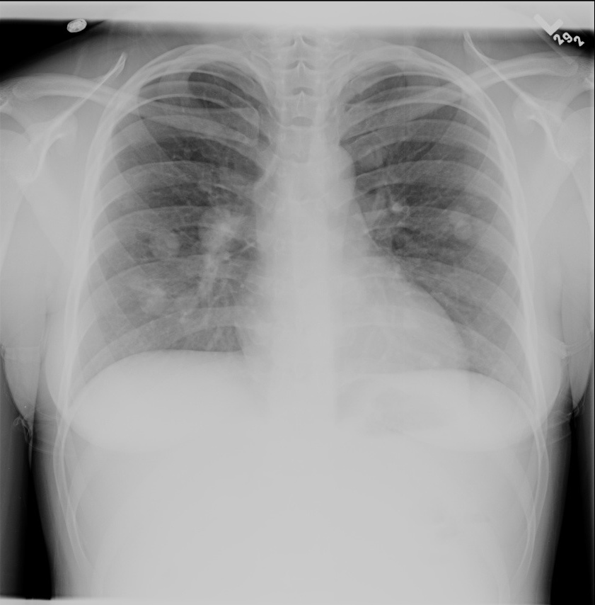 |

---

### Teste 04 — Novo Corte de TC
* **Resultado:** **2 detecções** (`conf = 0.24` e `0.21`).
* **Diagnóstico:** Nódulo sutil detectado corretamente no parênquima pulmonar.

| Imagem Original | Predição do Modelo (Treino 02) |
| :---: | :---: |
| 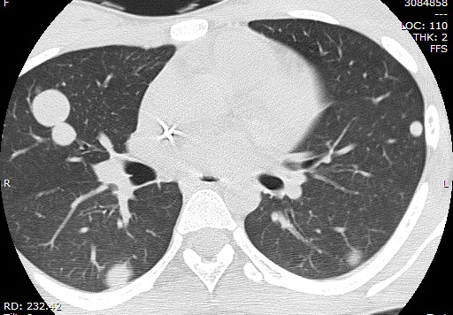 | 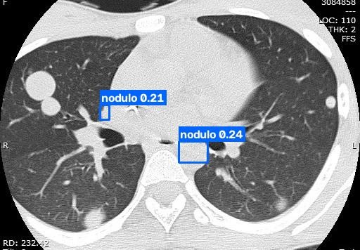 |

---

## 6. Estrutura de Arquivos desta Pasta
* [`RELATORIO_TREINO_02_ABNT.pdf`](RELATORIO_TREINO_02_ABNT.pdf): Relatório acadêmico completo em padrão ABNT (NBR 14724 / NBR 6023).
* [`weights/best.pt`](weights/best.pt): Pesos treinados do Modelo 02.
* [`resultado_completo_treino_lidc.zip`](resultado_completo_treino_lidc.zip): Pacote completo exportado do Google Colab.
* [`train_lidc_por_paciente.py`](train_lidc_por_paciente.py) e [`treino_02_colab.ipynb`](treino_02_colab.ipynb): Código e notebook do treinamento.
* [`avaliar_treino_02.py`](avaliar_treino_02.py): Script de inferência e avaliação das métricas.
* [`results.csv`](results.csv) e [`args.yaml`](args.yaml): Logs numéricos de todas as épocas.
